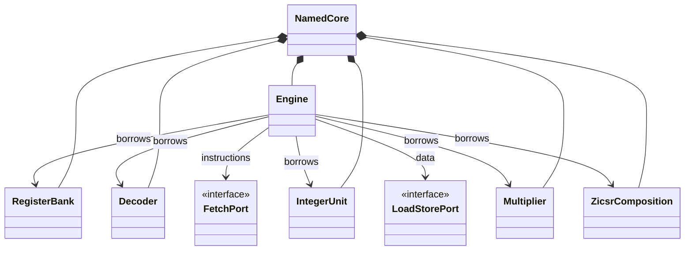

# Architecture

A core is an execution engine wired to concrete providers. A named preset owns
that assembly; an explicit composition owns and wires the same units itself.
The platform supplies instruction/data ports and owns its peripherals. All
borrowed providers must outlive the core and share its clock/reset domain.

| Namespace | Responsibility |
|---|---|
| `Presets` | Named sequential and pipeline assemblies |
| `Sequential` | Sequential ordering, decode/integer/multiply ports and units, memory/control contracts |
| `Pipeline` | Pipeline ordering and physical timing checks |
| `Storage` | Synchronous register banks and fetch/data memories |
| `Machine` | Zicsr composition, machine CSR state, trap vocabulary and machine instruction decoding |
| `Platform` | Timer, external interrupt helpers and buffered UART adapter |
| `Contracts` | Static capability/timing checks and composition contracts |
| `System` | Constructor-bound systems and fetch/load-store routers |

The engine owns instruction identity, PC, scheduling, dependency handling and the
ordered architectural decision. The register bank owns integer storage. The CSR
provider owns CSR mutation, trap state and counters. Arithmetic providers compute
results; they do not modify architectural registers, memory or peripherals.

The diagram summarizes a machine composition; base presets substitute stateless
terminations for unsupported multiplier/CSR ports. Compile-time selection removes
unselected hardware. A facade forwards signal interfaces combinationally rather
than introducing a scheduled adapter.

The engines share ISA semantics and providers where timing permits. They have
separate controllers because a sequential single-port register bank and an
overlapping pipeline need different scheduling and hazards. The pipeline uses
`IRv32DualReadRegisterPort`; the sequential engine uses `IRv32RegisterPort`.
Neither interface implies arbitrary interchangeability.

`RvOperationCoverage`, `RvTimingContract` and `RvPipelineContract` check declared
operation coverage and timing requirements during elaboration. They add no runtime
registry. A passing assertion cannot prove provider behavior or arbitrary wiring;
functional tests and implementation reports are still required.

The scheduled reference cores and their method-style buses have been removed.
Applications control execution through run/step/restart handshakes; see
[system composition](system.md) for complete device ownership and routing.
