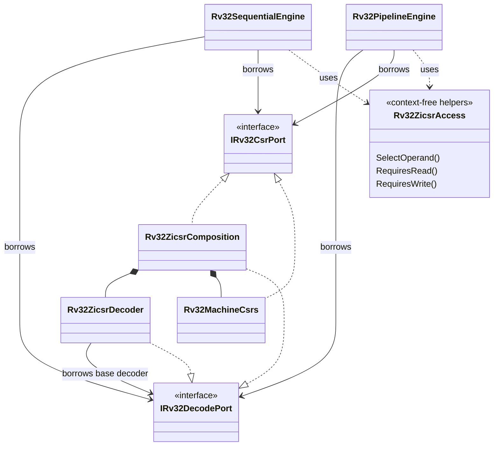

# Custom components and Zicsr composition

`Rv32ZicsrComposition<HART_ID = 0, TIMER_INTERRUPTS = false,
EXTERNAL_INTERRUPTS = false>` owns a `Rv32ZicsrDecoder` and a
`Rv32MachineCsrs` instance. It borrows a caller-owned base decoder. The composition implements
`IRv32DecodePort` and `IRv32CsrPort`, forwarding their signals combinationally
to private children. Consumers borrow these two interface views directly; the
facade adds neither state nor a scheduled adapter.

The composition adds Zicsr decoding and the existing machine CSR subset. It does
not itself select machine trap handling, add MRET decoding, or change the engine.
Those remain explicit architectural choices. Its constants describe the added
CSR and trap-state capabilities; callers still check their actual base decoder,
integer/multiply providers, machine decoder and register-file timing.

## Construction

A machine composition first creates its base decoder and Zicsr subsystem, then
adds the machine-instruction overlay. For example, these constructor statements
come from the pipeline machine preset:

```livt
baseDecoder = new Rv32iZmmulDecoder()
zicsr = new Rv32ZicsrComposition<0, true, true>(baseDecoder)
decoder = new Rv32MachineDecoder(zicsr)
engine = new Rv32PipelineEngine<RESET_PC, true>(
	registers,
	instructions,
	data,
	decoder,
	integer,
	multiplier,
	zicsr,
	noCustom
)
```

The platform directly supplies same-clock `zicsr.timerPending` and
`zicsr.externalPending` levels. Each interface input has one external
writer; only the composition drives the private child inputs. Hardware reset resets the owned state;
architectural restart travels through the engine's existing CSR clear command.
It never resets platform devices or the externally owned decoder.

A CSR-only composition passes `zicsr` directly to its sequential engine. Machine
compositions put `Rv32MachineDecoder` on top. Both named machine presets use the
same subsystem. Register storage and multiplier implementation
remain independent compile-time choices.

## Ownership and shared semantics



`Rv32ZicsrAccess` contains pure `static fn ...[]` helpers. Both engines use them
for immediate/register operand selection and CSR read/write intent. WRITE to rd=x0
suppresses the read; SET/CLEAR with encoded rs1=x0 or zimm=0 suppress the write.
A nonzero source register containing zero still has write intent. These rules
are independent of the engine's scheduling and of which CSRs a provider exposes.

Each engine still chooses when to query, commit, retire, enter a trap or return.
The CSR provider remains the only owner of CSR mutation and counters. Decoder
sampling, register/PC writes, interrupt boundaries and stall/drain rules retain
their existing contracts. The helpers add no scheduled call protocol.

## Custom instructions

`IRv32CustomInstructionPort` is the supported boundary for result-only custom
instructions that read `rs1` and `rs2`, optionally write `rd`, and may take
multiple cycles. Decode recognition is separate from execution recognition so a
pipeline can inspect a younger instruction while an older transaction completes.
The engine owns operand dependencies, PC, register writes, retirement, faults and
interrupt ordering.

A provider accepts stable `executeInstruction`, `left` and `right` on an idle edge
with `request` high. The engine holds the request and transaction inputs until the
provider raises `ready`; the result or synchronous fault cause remains stable until
a low-request release edge. The engine retains the instruction as the fault value.
Hardware reset cancels work. Restart and interrupts drain the accepted operation
before changing architectural state.

`Rv32CustomInstructionPair<FIRST, SECOND>` composes two providers and can be nested
to form a tree. It rejects overlapping decode or execution matches as illegal and
dispatches to neither provider. `Rv32XqdivInstruction` demonstrates the contract
with a 32-cycle unsigned division instruction in the custom-0 opcode space.
Division by zero reports an illegal-instruction fault. This example does not claim
the standard M extension; a side-effecting accelerator needs a separate contract
that defines memory, ordering and cancellation behavior.

```livt
core = new Rv32PipelineCore<
	Rv32DualReadRegisterBank,
	Rv32iDecoder,
	Rv32iIntegerUnit,
	Rv32NoMultiplier,
	Rv32NoCsrs,
	Rv32XqdivInstruction
>(instructions, data)
```

The generic types are compile-time structure. Named presets pass
`Rv32NoCustomInstruction`, so custom decode and execution state are absent from
those cores.

## Custom controls

A generic wrapper can only promise the interface in its type constraint. Expose
extra controls with a derived interface and typed wrapper, or assemble the concrete
core directly at the application composition root. `IRv32RetirementTracePort`
derives from `IRv32ControlPort` and adds a gated trace.
`Rv32RetirementTraceCore<TCORE>` wraps a standard core without retained state;
`RvRetirementTraceSystem<TCORE>` preserves the complete derived interface across
a system boundary. The standard `retired` event and `traceValid` refer to the same
cycle. This avoids a universal wrapper containing unrelated optional signals.

```livt
system = new RvRetirementTraceSystem<
	Rv32RetirementTraceCore<Rv32iSequentialCore>
>(instructions, data)
```

## Custom CSR functionality

Applications can continue to assemble `Rv32ZicsrDecoder` and an implementation
of `IRv32CsrPort` directly. Use this path for custom CSR state or side effects;
the convenience composition deliberately owns the existing machine provider.
It does not force a custom provider to inherit that implementation.

A replacement must obey the full port contract: access legality, read/write
intent, stable values at commit, clear priority, counters and trap/return commands
where required. Instruction extensions that fit the result-only transaction
contract use `IRv32CustomInstructionPort`; extensions that change fetch framing,
architectural state or memory ownership require a purpose-specific boundary. A
component interface alone does not guarantee ISA compliance, compatible timing,
or the resource results of a qualified preset.

### Integer datapath replacement

`IRv32IntegerPort` is the supported substitution boundary for the
RV32 integer datapath. The engine continuously drives `operation`, `left` and
`right`; the provider continuously drives `result`. The provider owns no state,
has no request handshake, and adds no cycle. Both engines sample the result at
their existing execution edge.

Implement all operations in `Rv32iOperations` and expose a matching capability
constant for the composition's `RvOperationCoverage` witness. Explicitly pass the
component to either engine where a preset passes `Rv32iIntegerUnit`. Test the
complete composition, including dependent instructions, branches, addresses,
x0 behavior and retirement. Synthesis must confirm the path still meets timing.
Use a request/completion interface for multicycle arithmetic; it cannot satisfy
this combinational contract.

## Explicit engine construction

Shared provider interfaces are in `Eccelerators.RiscV.Core`; standard providers
are in `Eccelerators.RiscV.Isa`; the two controllers are in `Sequential` and
`Pipeline`. Both engines take
providers in this order: register bank, instruction memory,
data memory, decoder, integer unit, multiplier, CSR provider and custom-instruction
provider. Select
`<RESET_PC, MACHINE_TRAPS>` for reset address and exception policy. Decoder and
provider types determine instruction support. Machine traps require a compatible
CSR provider; interrupts require machine traps. Absent units
use `Rv32NoMultiplier` and `Rv32NoCsrs` terminations.

For a base pipeline, these constructor statements illustrate the assembly:

```livt
registers = new Rv32DualReadRegisterBank()
decoder = new Rv32iDecoder()
integer = new Rv32iIntegerUnit()
noMultiplier = new Rv32NoMultiplier()
noCsrs = new Rv32NoCsrs()
noCustom = new Rv32NoCustomInstruction()
engine = new Rv32PipelineEngine(
	registers,
	instructions,
	data,
	decoder,
	integer,
	noMultiplier,
	noCsrs,
	noCustom
)
```

This fragment assumes owned fields and borrowed memories are declared by the
parent. Add capability/timing witnesses and wire control/observation as in the
[base pipeline preset](../src/Presets/Rv32iPipelineCore.lvt). A sequential assembly
uses `Rv32RegisterBank` and `Rv32SequentialEngine` instead. Providers have exclusive
mutable ownership unless an explicit arbiter establishes sharing.

An existing interface permits replacement only within its operation and timing
contract. Adding an arbitrary instruction also requires decode, execution/dispatch,
legality, retirement/fault semantics and tests. Composition is not a runtime plugin
registry. Extend cohesive functional units and keep storage/implementation choices
as compile-time parameters.

Keep sampled state in local values before passing it to pure helpers. Preserve
combinational interface forwarding and explicit clocked controller updates:
replacing either with scheduled helper calls changes hardware timing. Preserve
the documented sampling and publication edges when refactoring a controller.
